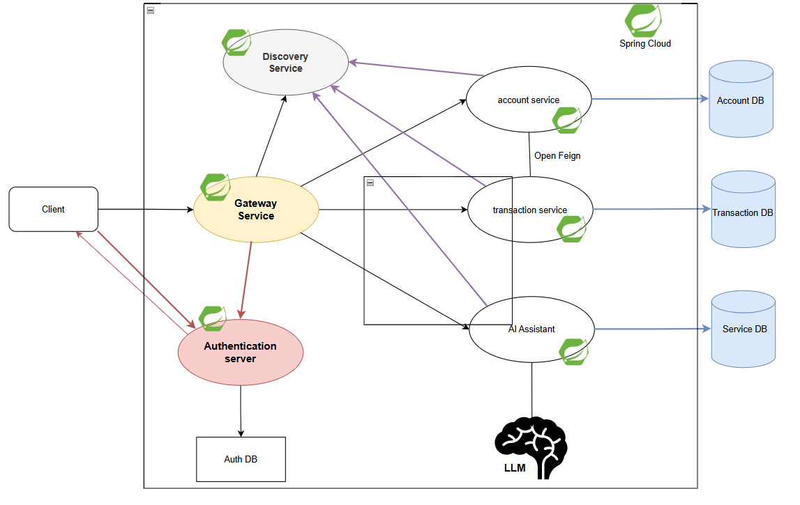

# Test ADRIA

**Réalisé par :** Mohamed SAIFI
**Filière :** BDCC II, Département Mathématiques et Informatique
**Année universitaire :** 2026/2027

---

## Partie B : Conception et architecture

| Composant | Rôle |
|---|---|
| Gateway (8080) | Point d'entrée unique, routage via Eureka |
| Eureka (8761) | Registre des services, découverte dynamique |
| Config-service (8888) | Centralise `bank.transaction.max-amount=1000` |
| account-service (8081) | Comptes et soldes, exposés en REST, GraphQL et MCP |
| transaction-service (8082) | Transactions et virements, appelle account-service via OpenFeign |
| assistant-service | Agent IA Spring AI dont les outils sont les serveurs MCP des deux services |
| Kafka | Topic `bank.transactions.created`, clé = `accountId` |
| event-consumer-service | Consomme et journalise les événements |
| Keycloak | Authentification et autorisations (prévu dans l'architecture cible) |

### Choix de conception

- **Séparation en couches** : `domain / repository / service / web/rest / web/graphql / mcp`. Les trois contrôleurs (REST, GraphQL, MCP) appellent la même couche `service`. Aucune logique métier n'est dans les contrôleurs : une règle n'est écrite qu'une fois.
- **Une base par micro-service.** `Transaction` ne porte pas de relation JPA vers `Account`, seulement un `accountId`. La cohérence passe par les appels OpenFeign.
- **Types monétaires.** L'énoncé impose `balance: double` côté compte et `BigDecimal` côté transaction. La conversion est explicite (`BigDecimal.valueOf`). Un `BigDecimal` serait préférable pour le solde afin d'éviter les erreurs d'arrondi.

---

## Partie C : Micro-services fonctionnels

### C.1 Account-Service

**Modèle :** `id` (UUID), `customerReference`, `status` (ACTIVE | BLOCKED), `currency`, `balance`.

| Connecteur | Accès | Opérations |
|---|---|---|
| REST | Port : 8081 | création, liste, détail, solde, blocage, activation, ajustement du solde |
| GraphQL | http://localhost:8081/graphiql | `accounts`, `accountById`, `accountBalance`, `createAccount`, `blockAccount`, `activateAccount` |
| MCP | http://localhost:8081/sse | 6 outils : `listAccounts`, `getAccount`, `getAccountBalance`, `createAccount`, `blockAccount`, `activateAccount` |

L'ajustement du solde utilise un verrou pessimiste pour éviter deux mises à jour concurrentes. Il refuse un compte bloqué ou un solde négatif.

### C.2 Transaction-Service

**Modèle :** `id`, `accountId`, `amount` (BigDecimal), `currency`, `merchantCategory`, `country`, `createdAt` (Instant).

**Règles métier appliquées dans `TransactionService` :**

- Le montant doit être strictement positif et inférieur ou égal à `bank.transaction.max-amount`.
- Le compte doit exister et être actif.
- La devise de la transaction doit être celle du compte.
- Le solde du compte est consulté avant l'opération. Après l'enregistrement de la transaction, le solde est mis à jour.
- **Virement** entre deux comptes : vérification des deux comptes et de la devise, débit de la source, crédit de la destination, deux transactions enregistrées (`TRANSFER_OUT` et `TRANSFER_IN`). Si le crédit échoue, le débit est compensé.

| Connecteur | Accès |
|---|---|
| REST | `POST /api/transactions`, `POST /api/transactions/transfers`, `GET /api/transactions/{id}`, `GET /api/transactions?accountId=` |
| GraphQL | http://localhost:8082/graphiql (`createTransaction`, `transfer`, `transactionById`, `transactionsByAccount`) |
| MCP | http://localhost:8082/sse (`createTransaction`, `transfer`, `getTransaction`, `listTransactions`) |

### C.3 Communication OpenFeign et tolérance aux pannes (Resilience4J)

- `AccountClient` est un client **OpenFeign** déclaré avec `@FeignClient(name = "account-service")`. Le nom est résolu via Eureka.
- `AccountGateway` enveloppe le client avec Resilience4J :
    - **CircuitBreaker** `accountService` : fenêtre de 10 appels, ouverture à 50 % d'échecs après 5 appels minimum, 10 s en état ouvert, puis 3 appels d'essai en semi-ouvert.
    - **Retry** : 3 tentatives espacées de 500 ms, uniquement sur la **lecture** du compte.
    - **Fallback** : si account-service est injoignable ou si le circuit est ouvert, le service répond **503** avec un message clair. Il ne valide jamais une opération financière sans réponse du compte (politique « fail safe »).
- **Pas de retry sur le débit** : après un timeout, l'opération a pu être exécutée côté compte, et la rejouer débiterait deux fois.
- Les erreurs 4xx (compte introuvable, solde insuffisant) ne sont pas des pannes et ne comptent pas dans le circuit breaker.
- Timeouts Feign : connexion 2 s, lecture 3 s.

---

## Partie D : Micro-services techniques

### D.1 Spring Cloud Gateway (port 8080)

Les routes sont déclarées en Java (`GatewayConfig`) et utilisent `lb://` pour résoudre les services via Eureka avec répartition de charge.

| Chemin | Service cible |
|---|---|
| `/api/accounts/**` | account-service |
| `/api/transactions/**` | transaction-service |
| `/accounts/graphql` | account-service (`/graphql`) |
| `/transactions/graphql` | transaction-service (`/graphql`) |
| `/api/chat/**` | assistant-service |

### D.2 Eureka Discovery Service (port 8761)

Le serveur Eureka (`@EnableEurekaServer`) ne s'enregistre pas lui-même. Les services s'enregistrent au démarrage, ce qui évite de coder des URL en dur.

### D.3 Config-service (port 8888)

Le config-service (`@EnableConfigServer`, backend `native`) distribue `bank.transaction.max-amount=1000` à tous les clients. Les services importent leur configuration avec `spring.config.import=optional:configserver:http://localhost:8888`.